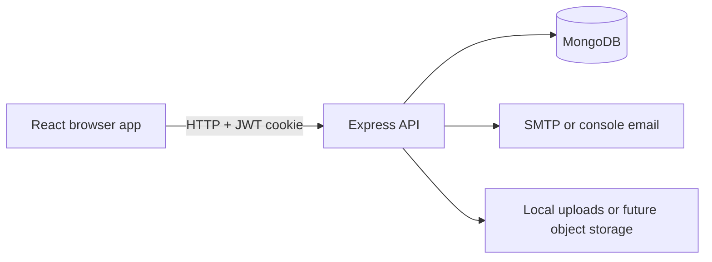

# PropertyHub

PropertyHub is a Lahore-focused real estate marketplace for discovering, listing, moderating, and inquiring about residential and commercial properties.

[](https://propertyhub-blush.vercel.app/)
[](https://react.dev/)
[](https://expressjs.com/)
[](https://mongoosejs.com/)
[](https://nodejs.org/)

**Quick links:** [Live Demo](https://propertyhub-blush.vercel.app/) | [Documentation](./docs/DEPLOYMENT.md) | [Report Bug](https://github.com/IFFAT12375/propertyhub/issues/new) | [Request Feature](https://github.com/IFFAT12375/propertyhub/issues/new)

## 2. Screenshots / Demo
[](https://propertyhub-blush.vercel.app/)

## 3. The Problem and the Solution

**Problem:** Property seekers in Lahore often need to compare fragmented listings without knowing whether a property is available or has passed moderation. Property owners and agents also need one place to publish listings, manage availability, and respond to interested buyers or tenants.

**Solution:** PropertyHub provides public search and detail pages, role-based seller and administrator dashboards, favorites, verified inquiries, seller applications, listing moderation, and account management. It separates browsing from publishing while keeping listing status and contact visibility visible.

**Motivation:** PropertyHub was built as a practical software engineering project rather than a feature exercise. It brought product discovery, system design, full-stack implementation, testing, deployment, and product ownership together in one real estate marketplace, with an emphasis on dependable workflows and maintainable architecture.

## 4. Key Features

- Browse approved, available properties for sale or rent across predefined Lahore areas.
- Filter listings by area, category, type, purpose, price, and pagination.
- Register and log in with a short-lived access token and HttpOnly refresh-token cookie.
- Save and remove favorite properties for authenticated accounts.
- Apply for owner or agent seller access and track application decisions.
- Create, edit, archive, and update the availability of seller-owned listings.
- Upload 1-10 JPG, PNG, or WebP property images, with file signature and size validation.
- Moderate seller applications and property listings through administrator-only workflows.
- Suspend or reactivate seller accounts and review listing/users as an administrator.
- Submit guest or authenticated inquiries, verify guest email links, and manage seller follow-up statuses.

## 5. Tech Stack

| Layer | Technology |
|---|---|
| Frontend | React 19, Vite 8, Redux Toolkit, RTK Query, React Router 7 |
| Backend | Node.js, Express 5 |
| Database | MongoDB, Mongoose 9 |
| Authentication | bcryptjs, JSON Web Tokens, HttpOnly refresh cookie |
| Email | Nodemailer with console or SMTP delivery |
| Validation and Security | Zod, Helmet, CORS allowlist, express-rate-limit |
| DevOps/Hosting | Vercel for separate frontend and backend projects |
| Testing/Tooling | Node.js test runner, Supertest, ESLint |

## 6. Requirements

### Functional Requirements

- **FR-1:** Visitors can browse, search, filter, and open public property details.
- **FR-2:** Users can register, log in, refresh an authenticated session, log out, and update a profile.
- **FR-3:** Registered users can save and remove favorite properties.
- **FR-4:** Guests and registered users can submit inquiries; guest inquiries require verification.
- **FR-5:** Users can apply for seller access and track application status.
- **FR-6:** Approved sellers can create, edit, archive, or update the availability of their listings.
- **FR-7:** Sellers can control whether their account phone number appears publicly.
- **FR-8:** Administrators can approve or reject seller applications and property listings.
- **FR-9:** Administrators can list users and suspend or reactivate accounts.
- **FR-10:** Sellers can view and update the follow-up status of verified inquiries.

### Non-Functional Requirements

- **NFR-1:** Passwords are hashed with bcrypt before storage.
- **NFR-2:** Protected endpoints enforce JWT authentication and role authorization.
- **NFR-3:** Request bodies and route parameters use Zod validation with structured API errors.
- **NFR-4:** Authentication and inquiry routes use configurable rate limits.
- **NFR-5:** Property search supports pagination and server-side filters.
- **NFR-6:** The interface uses responsive CSS for desktop and mobile layouts.
- **NFR-7:** Uploaded image type, signature, count, and size are validated.
- **NFR-8:** API health and database readiness endpoints support monitoring.
- **NFR-9:** Accessibility beyond semantic markup is `(planned)`.
- **NFR-10:** Automated browser end-to-end coverage is `(planned)`.
- **NFR-11:** Durable object storage and a shared serverless rate-limit store are `(planned)`.
- **NFR-12:** Dynamic listing metadata and server-rendered SEO content are `(planned)`.

## 7. Architecture / Project Structure

The React client communicates with the Express API through RTK Query. MongoDB stores users, authentication sessions, properties, favorites, applications, and inquiries. Express middleware handles validation, authentication, authorization, uploads, CORS, rate limiting, logging, and structured errors.

```text
.
├── client/
│   ├── src/
│   │   ├── components/     # Shared layout and property UI
│   │   ├── features/       # Authentication Redux state
│   │   ├── pages/          # Public, seller, and administrator pages
│   │   ├── routes/         # React Router and protected routes
│   │   └── services/api/   # RTK Query API endpoints
│   ├── public/             # robots.txt and sitemap.xml
│   └── vercel.json         # SPA route rewrites
├── server/
│   ├── src/
│   │   ├── controllers/    # HTTP request handlers
│   │   ├── middlewares/    # Auth, validation, uploads, errors
│   │   ├── models/         # Mongoose schemas
│   │   ├── routes/         # Versioned Express routes
│   │   ├── services/       # Database and business logic
│   │   ├── tests/          # Node test runner and Supertest tests
│   │   └── validators/     # Zod request schemas
│   └── uploads/            # Local development image storage
└── docs/                   # Product, testing, and deployment notes
```



## 8. Getting Started

### Prerequisites

- Node.js 20.19 or newer
- npm
- MongoDB local instance or MongoDB Atlas

### Clone & install

```sh
git clone https://github.com/IFFAT12375/propertyhub.git
cd propertyhub
npm --prefix server install
npm --prefix client install
```

### Configuration

Copy both example files before starting:

```sh
cp server/.env.example server/.env
cp client/.env.example client/.env
```

Frontend environment variables:

| Variable | Local example | Purpose |
|---|---|---|
| `VITE_API_BASE_URL` | `http://localhost:5000/api/v1` | Base URL used by RTK Query |

Server environment variables:

| Variable | Purpose |
|---|---|
| `NODE_ENV` | Runtime mode: development, test, or production |
| `PORT` | Local HTTP port |
| `MONGO_URI` | MongoDB connection URI |
| `CORS_ORIGINS` | Comma-separated exact browser origins |
| `LOG_LEVEL` | Winston log level |
| `RATE_LIMIT_WINDOW_MS` | Shared rate-limit window in milliseconds |
| `RATE_LIMIT_MAX` | General request limit |
| `AUTH_RATE_LIMIT_MAX` | Login and registration request limit |
| `INQUIRY_RATE_LIMIT_MAX` | Inquiry request limit |
| `JSON_BODY_LIMIT` | Maximum JSON body size |
| `JWT_ACCESS_SECRET` | At least 32-character access-token signing secret |
| `ACCESS_TOKEN_TTL` | Access-token lifetime, such as `15m` |
| `REFRESH_TOKEN_TTL_DAYS` | Refresh-session lifetime in days |
| `PUBLIC_API_URL` | Public API origin used to build image URLs |
| `PUBLIC_WEB_URL` | Public frontend origin |
| `INQUIRY_VERIFICATION_TTL_MINUTES` | Guest inquiry verification lifetime |
| `EMAIL_PROVIDER` | `console` for local links or `smtp` for delivery |
| `EMAIL_FROM` | From name and address |
| `SMTP_HOST` | SMTP server host |
| `SMTP_PORT` | SMTP server port |
| `SMTP_SECURE` | Use implicit TLS |
| `SMTP_USER` | SMTP username |
| `SMTP_PASSWORD` | SMTP password |
| `UPLOAD_DIR` | Published local upload directory |

The optional admin bootstrap also reads `ADMIN_NAME`, `ADMIN_EMAIL`, `ADMIN_PHONE`, and `ADMIN_PASSWORD`. It is blocked in test and production modes.

Never commit real values from `.env` files. Never place SMTP passwords, JWT secrets, database credentials, or admin credentials in `VITE_*` variables.

### Run

Start MongoDB, then run the API and client in separate terminals:

```sh
npm --prefix server run dev
npm --prefix client run dev
```

The default client is `http://localhost:5173` and the default API is `http://localhost:5000`.

Production-style local API start:

```sh
npm --prefix server start
npm --prefix client run build
npm --prefix client run preview
```

The Vite preview command is only a local preview of the built frontend; use the deployment configuration for the production environment.

### Test

```sh
npm --prefix server test
npm --prefix server audit --omit=dev
npm --prefix client run lint
npm --prefix client run build
```

See [docs/TESTING_PLAN.md](./docs/TESTING_PLAN.md) for manual account setup and workflows.

### Docker

Docker instructions are `(not applicable)`: no Dockerfile or docker-compose configuration is currently present.

## 9. Usage

1. Open the [live frontend](https://propertyhub-blush.vercel.app/) or `http://localhost:5173`.
2. Browse `/properties`, filter the available listings, and open a property detail page.
3. Register an ordinary account, then submit seller access from `/seller/apply`.
4. Configure a local administrator using the development-only bootstrap command:

   ```sh
   npm --prefix server run create-admin
   ```

5. Sign in as the administrator and approve the seller application and property listings.
6. Sign in as the approved seller, create a listing, and manage availability or inquiries.

Check the API:

```sh
curl http://localhost:5000/api/v1/health
curl http://localhost:5000/api/v1/health/ready
```

Public properties request:

```sh
curl "http://localhost:5000/api/v1/properties?page=1&limit=10"
```

User registration request:

```sh
curl -X POST http://localhost:5000/api/v1/auth/register \
  -H "Content-Type: application/json" \
  -d '{"name":"Example User","email":"user@example.test","phone":"+92 300 0000000","password":"example-password"}'
```

## 10. Roadmap

- [x] Public property search and detail pages
- [x] User registration, login, refresh sessions, logout, and profile updates
- [x] Favorites and verified inquiry workflows
- [x] Seller applications and administrator approvals
- [x] Seller listing management and property moderation
- [x] Vercel-ready SPA rewrites and basic crawler files
- [ ] Durable property-image storage for Vercel deployments
- [ ] Shared serverless rate-limit storage
- [ ] Server-rendered or prerendered listing metadata
- [ ] Dynamic public sitemap entries for every approved listing
- [ ] Canonical custom domain configuration
- [ ] Automated frontend end-to-end tests
- [ ] CI workflow for lint, tests, build, and dependency audit
- [ ] Docker development configuration

## 11. Contributing

1. Fork the repository.
2. Create a branch:

   ```sh
   git checkout -b feature/short-description
   ```

3. Keep changes focused and follow Conventional Commit prefixes: `feat:`, `fix:`, `docs:`, `refactor:`, `test:`, or `chore:`.
4. Run the relevant frontend lint/build and backend test commands before pushing.
5. Push the branch and open a Pull Request explaining what changed and why.

See [CONTRIBUTING.md](./CONTRIBUTING.md) for repository workflow details.

## 12. License

PropertyHub is licensed under the [MIT License](./LICENSE).

## 13. Author & Acknowledgements

- **Author:** [IFFAT12375](https://github.com/IFFAT12375)
- **LinkedIn:** [Iffat Sattar](https://www.linkedin.com/in/iffat-sattar-134b62182/)

Built with React, Express, MongoDB, Mongoose, Redux Toolkit, RTK Query, Zod, Nodemailer, and Vite.
